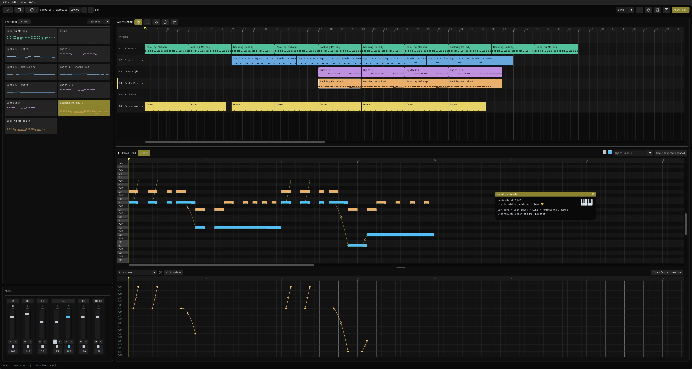

# *duckmidi*

A MIDI editor for the modern age, made with love. 💛

*duckmidi* aims to offer a simple workspace for compositions, arrangements, or just listening to your favorite MIDI tunes. It combines familiar music-editing tools with quality-of-life features that make working with MIDI 1.0 easier.

**This program is in active development; expect bugs.**



## \*Disclaimer\*

While the design, usability, UI, and goals of this program were dictated by a human, the codebase itself was **generated and modified with *Codex***.

## Capabilities

- Create, edit, import, and export MIDI files
   - You can import .MUS files too, if you're into that sort of thing :P.
- Arrange reusable note and automation patterns.
- Edit and automate MIDI events within the GUI - pitch bends, velocity, modulation, reverb, chorus, portamento, sustain, sostenuto, and more. Use LFOs for repeating effects that snap to the beat.
- Record piano notes with your keyboard! 
- Various quality of life options - wait-for-input recording, overlapping takes, and even a metronome!
- Customize keyboard shortcuts (and modifiers) and simple percussion key mappings.
- Give notes independent pitch bends and controller effects by assigning per-note MIDI ports. Up to 128 ports are supported. (Playback support depends on the receiving application).
- Use an SF2/SF3 SoundFont or an external MIDI output.
- Save compositions as `.duck` projects or retain editor data in exported MIDI files.
- Export MIDI, WAV (PCM), MP3, AAC, Ogg Vorbis, Opus, and FLAC.
- Add export formats through the plugin API. 
   - The bundled M64 plugin converts General MIDI arrangements into SM64 sequences; transforming a previously arduous task into a quick and painless experience.

## Performance

Tested against *Release* v0.10.0

<details>
  <summary>Click to expand</summary>

   - **Window active, idling**
      - RAM Usage: ~300 MiB
      - CPU Usage (all threads): ~1%
      - GPU Usage: ~1%
   - **Window inactive, idling**
      - RAM Usage: ~300 MiB
      - CPU Usage (all threads): ~0.4%
      - GPU Usage: ~0.1%
   - **Window minimized, idling**
      - RAM Usage: ~300 MiB
      - CPU Usage (all threads): ~0.3%
      - GPU Usage: ~0%
   - ***Loading* a ~48k note midi file with ~143k events**
      - RAM Usage: ~700 MiB - ~1.0 GiB
      - CPU Usage (all threads): ~4.4%
      - GPU Usage: ~13%
   - **Large MIDI file loaded, window active**
      - RAM Usage: ~1.0 GiB
      - CPU Usage (all threads): ~5.2%
      - GPU Usage: ~13%
   - **Large MIDI file, window inactive & window minimized**
      - RAM Usage: ~1.0 GiB
      - CPU Usage (all threads): ~0.1%
      - GPU Usage: ~0%
   - **Large MIDI file, playback, active**
      - RAM Usage: ~1.1 GiB - The test lied >:(
      - CPU Usage (all threads): ~5.2%
      - GPU Usage: ~12.3%
   - **Large MIDI file, WAV Export**
      - RAM Usage: Can't confirm yet.
      - CPU Usage (all threads): ~10%
      - GPU Usage: ~12.8%
      - Rendering Time: 80 seconds for 16:37 of audio
</details>

## Planned

- Core
   - Performance
      - Improve Resource consumption
      - Improve GUI performance; it suffers with complex MIDI compositions
   - GUI
      - Pattern colors
      - 'Unslop' parts of the GUI
      - More keyboard shortcuts.
   - MIDI Input Support
   - Better implementation for Polyphonic Aftertouch
   - API Expansion
- Plugins
   - M64 - Export to repo
   - M64 - Automatic adjustment of sequence memory code to match export requirements
   - M64 - Loop Points
   - OoT/MM Exporting
- Probably a lot more


## Getting Started

*Full* builds include *TimGM6mb.sf2* as the default SoundFont and a sample project that opens on initial launch. 

*Core* builds contain only the *duckmidi* program and necessary libraries; you can select a local SoundFont in **Edit > Preferences**, then create a project or open a MIDI file.

See the [user guide](docs/user-guide.md), [M64 export guide](docs/sm64-export.md), and [plugin API reference](docs/plugin-api.md).

## Building

Build with [CMake](https://cmake.org/download/) 3.22 or newer, Ninja, and a C17/C++17 compiler. Run the build commands from the project folder containing `CMakeLists.txt` and `vendor/`.

The Windows build uses the included SDL3, FluidSynth, and FFmpeg dependencies. Other platforms use installed development packages: SDL 3.2 or newer, FluidSynth 2.5.4 or newer, and FFmpeg 7.1 or newer with the LAME, Vorbis, and Opus encoders enabled.

The Windows FFmpeg libraries include only the audio export components. See [minimal FFmpeg build instructions](docs/ffmpeg-build.md) to rebuild or validate them.

Building on macOS or Linux has not been tested yet.

### Windows

Install [MSYS2](https://www.msys2.org/), then open **MSYS2** and update its packages:

```sh
pacman -Syu
```

If asked to close the terminal, reopen it and repeat the update. Install the compiler and build tools:

```sh
pacman -S --needed mingw-w64-ucrt-x86_64-gcc mingw-w64-ucrt-x86_64-cmake mingw-w64-ucrt-x86_64-ninja
```

To build from another terminal, add `C:\msys64\ucrt64\bin` to your user PATH in Windows Environment Variables, then reopen that terminal; adjust the path if MSYS2 was installed elsewhere.

From the project folder, run:

```console
cmake -S . -B build/development/cmake -G Ninja -DCMAKE_BUILD_TYPE=Release -DCMAKE_C_COMPILER=gcc -DCMAKE_CXX_COMPILER=g++
cmake --build build/development/cmake
ctest --test-dir build/development/cmake --output-on-failure
```

Open `build/development/cmake/bin/duckmidi.exe`. Its runtime DLLs and `plugins/` folder are placed beside it. Choose `vendor/TimGM6mb.sf2` in Preferences, or select another SoundFont.

### macOS

Install Apple's [Command Line Tools](https://developer.apple.com/documentation/xcode/installing-the-command-line-tools/):

```sh
xcode-select --install
```

Install [Homebrew](https://brew.sh/), follow its PATH setup instructions, then install the dependencies:

```sh
brew install cmake ninja pkgconf sdl3 fluid-synth ffmpeg
```

From the project folder, build and run:

```sh
cmake -S . -B build/development/cmake -G Ninja -DCMAKE_BUILD_TYPE=Release
cmake --build build/development/cmake
ctest --test-dir build/development/cmake --output-on-failure
./build/development/cmake/bin/duckmidi
```

If CMake cannot find Homebrew packages, run `brew --prefix` and add the returned path to the configure command as `-DCMAKE_PREFIX_PATH=<path>`.

### Arch Linux

Install the compiler and [development packages](https://archlinux.org/packages/extra/x86_64/sdl3/):

```sh
sudo pacman -Syu --needed base-devel cmake ninja pkgconf sdl3 fluidsynth alsa-lib ffmpeg
```

From the project folder, build and run:

```sh
cmake -S . -B build/development/cmake -G Ninja -DCMAKE_BUILD_TYPE=Release
cmake --build build/development/cmake
ctest --test-dir build/development/cmake --output-on-failure
./build/development/cmake/bin/duckmidi
```

### Ubuntu / Debian

These steps target Ubuntu 26.04+ or Debian 13+, which provide SDL3 development packages. Older releases need [SDL3 installed from source](https://wiki.libsdl.org/SDL3/README-linux) first.

Install the build tools and development packages:

```sh
sudo apt update
sudo apt install build-essential cmake ninja-build pkg-config git libsdl3-dev libasound2-dev libglib2.0-dev libsndfile1-dev libavcodec-dev libavformat-dev libavutil-dev libswresample-dev
```

Stable distribution packages may provide an older FluidSynth than required. From the project folder, build [FluidSynth 2.5.4](https://github.com/FluidSynth/fluidsynth/tree/v2.5.4) into a local dependency directory:

```sh
git clone --depth 1 --branch v2.5.4 https://github.com/FluidSynth/fluidsynth.git build/development/deps/fluidsynth
cmake -S build/development/deps/fluidsynth -B build/development/deps/fluidsynth-build -G Ninja -DCMAKE_BUILD_TYPE=Release -DCMAKE_INSTALL_PREFIX:PATH=build/development/deps/install -DCMAKE_INSTALL_LIBDIR=lib
cmake --build build/development/deps/fluidsynth-build
cmake --install build/development/deps/fluidsynth-build
```

Build duckmidi using that local dependency:

```sh
cmake -S . -B build/development/cmake -G Ninja -DCMAKE_BUILD_TYPE=Release -DCMAKE_PREFIX_PATH:PATH=build/development/deps/install
cmake --build build/development/cmake
ctest --test-dir build/development/cmake --output-on-failure
./build/development/cmake/bin/duckmidi
```

Select a SoundFont in **Edit > Preferences** after launching.

### Package a Build

To include the *TimGM6mb* SoundFont and sample project, enable the *Production* option and rebuild:

```console
cmake -S . -B build/development/cmake -DDUCKMIDI_PRODUCTION=ON
cmake --build build/development/cmake
```

Use `-DDUCKMIDI_PRODUCTION=OFF` for an application-only package. To create a new dated delivery folder under `build/`, run:

```console
cmake --build build/development/cmake --target deliver
```

Each delivery includes the executable, M64 plugin, required Windows runtime DLLs, documentation, and licenses. macOS/Linux builds continue to use their installed dependency libraries. To stage files in a local folder instead:

```console
cmake --install build/development/cmake --prefix build/development/package --strip
```

## Libraries and Assets

*duckmidi* uses SDL3, Dear ImGui, FluidSynth, FFmpeg, RtMidi, and Iconoir artwork. *Full* builds include *TimGM6mb.sf2*. See [third-party notices](THIRD_PARTY_NOTICES.md) for licenses and sources.

The M64 converter's public API is in `include/m64export/`; its implementation and plugin adapter are in `libraries/m64export/`.

## Support and Development

When reporting a bug, include the application version, steps to reproduce it, and what you expected to happen.

## License

*duckmidi* is available under the [MIT license](LICENSE). Dependencies, SoundFonts, and other third-party assets retain their respective licenses.
