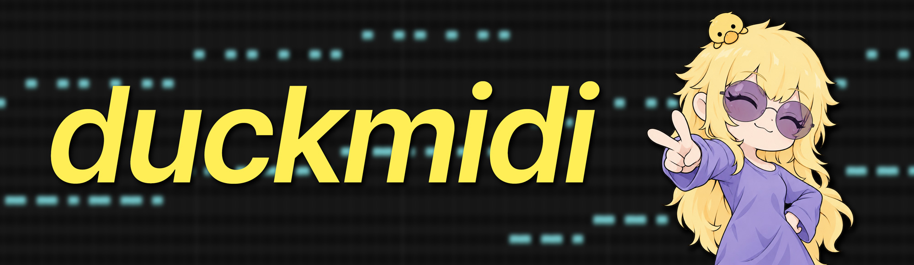
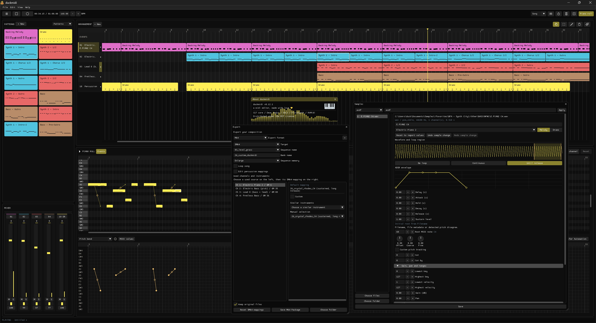

# *duckmidi*

A MIDI editor for the modern age, made with love. 💛

*duckmidi* aims to offer a simple workspace for compositions, arrangements, or just listening to your favorite MIDI tunes. It combines familiar music-editing tools with quality-of-life features that make working with MIDI 1.0 easier.

**This program is in active development; expect bugs.**



## \*Disclaimer\*

While the design, usability, UI, and goals of this program were dictated by a human, the codebase itself was **generated and modified using *Codex* & *Claude***.

## Capabilities

- Create, edit, import, and export MIDI files
   - You can import .MUS files too, if you're into that sort of thing :P.
- Arrange reusable note and automation patterns.
- Edit and automate MIDI events within the GUI - pitch bends, velocity, modulation, reverb, chorus, portamento, sustain, sostenuto, and more. Use LFOs for repeating effects that snap to the beat.
- Record piano notes with your keyboard! 
- Various quality of life options - wait-for-input recording, overlapping takes, and even a metronome!
- Customize keyboard shortcuts (and modifiers) and simple percussion key mappings.
- Give notes independent pitch bends and controller effects by assigning per-note MIDI ports. Up to 128 ports are supported. (Playback support depends on the receiving application).
- Use an SF2/SF3 SoundFont or an external MIDI output.
- Bring your own samples! Import audio, shape it in the sample editor, and play it in place of any SoundFont instrument.
- Save compositions as `.duck` projects or retain editor data in exported MIDI files.
- Export MIDI, WAV (PCM), MP3, AAC, Ogg Vorbis, Opus, and FLAC.
- Add export formats through the plugin API. 
   - The bundled M64 & OoT plugins converts General MIDI arrangements into their respective sequences; transforming a previously arduous task into a quick and painless experience.
   - Your custom samples can be exported as well, and every change made to your game repository can be quickly reverted.


## Getting Started

*Full* builds include *TimGM6mb.sf2* as the default SoundFont and a sample project that opens on initial launch. 

*Core* builds contain only the *duckmidi* program and necessary libraries; you can select a local SoundFont in **Edit > Preferences**, then create a project or open a MIDI file.

See the [user guide](docs/user-guide.md), [M64 export guide](docs/sm64-export.md), and [plugin API reference](docs/plugin-api.md).

## Building

You'll need [CMake](https://cmake.org/download/) 3.22+, Ninja, a C17/C++17 compiler and Python 3 (for the tests). Run the commands below from the project folder.

On Windows, SDL3, FluidSynth and FFmpeg are already in `vendor/`. Elsewhere, install SDL 3.2+, FluidSynth 2.5.4+ and FFmpeg 7.1+ (with LAME, Vorbis and Opus).

Once it's running, pick a SoundFont in **Edit > Preferences**.

The macOS and Linux steps haven't had in-depth testing yet.

### Windows

1. Install [MSYS2](https://www.msys2.org/) to `C:\msys64`.
2. Open **MSYS2 UCRT64** from the Start menu and install the tools. If `pacman -Syu` closes the terminal, reopen it and run it again.

   ```sh
   pacman -Syu
   pacman -S --needed mingw-w64-ucrt-x86_64-gcc mingw-w64-ucrt-x86_64-cmake mingw-w64-ucrt-x86_64-ninja mingw-w64-ucrt-x86_64-python
   ```

3. Build, test and launch:

   ```sh
   cd /c/path/to/duckmidi
   cmake -S . -B build/development/cmake -G Ninja -DCMAKE_BUILD_TYPE=Release
   cmake --build build/development/cmake
   ctest --test-dir build/development/cmake --output-on-failure
   ./build/development/cmake/bin/duckmidi.exe
   ```

`vendor/TimGM6mb.sf2` works as a SoundFont.

To use Command Prompt or PowerShell instead, add `C:\msys64\ucrt64\bin` to your PATH and add `-DCMAKE_C_COMPILER=gcc -DCMAKE_CXX_COMPILER=g++` to the first `cmake` command.

The bundled FFmpeg only includes what audio export needs. To rebuild it, see [docs/ffmpeg-build.md](docs/ffmpeg-build.md).

### macOS

1. In **Terminal**, install Apple's [Command Line Tools](https://developer.apple.com/documentation/xcode/installing-the-command-line-tools/), then [Homebrew](https://brew.sh/) and the dependencies:

   ```sh
   xcode-select --install
   brew install cmake ninja pkgconf python sdl3 fluid-synth ffmpeg
   ```

2. Build, test and launch:

   ```sh
   cmake -S . -B build/development/cmake -G Ninja -DCMAKE_BUILD_TYPE=Release
   cmake --build build/development/cmake
   ctest --test-dir build/development/cmake --output-on-failure
   ./build/development/cmake/bin/duckmidi
   ```

If CMake can't find the Homebrew packages, add `-DCMAKE_PREFIX_PATH="$(brew --prefix)"` to the first `cmake` command.

### Arch Linux

1. In a terminal, install the tools and [libraries](https://archlinux.org/packages/extra/x86_64/sdl3/):

   ```sh
   sudo pacman -Syu --needed base-devel cmake ninja pkgconf python sdl3 fluidsynth alsa-lib ffmpeg
   ```

2. Build, test and launch:

   ```sh
   cmake -S . -B build/development/cmake -G Ninja -DCMAKE_BUILD_TYPE=Release
   cmake --build build/development/cmake
   ctest --test-dir build/development/cmake --output-on-failure
   ./build/development/cmake/bin/duckmidi
   ```

### Ubuntu / Debian

You'll need Ubuntu 26.04+ or Debian 13+ for SDL3. On older releases, [build SDL3 from source](https://wiki.libsdl.org/SDL3/README-linux) first.

1. In a terminal, install the tools and libraries:

   ```sh
   sudo apt update
   sudo apt install build-essential cmake ninja-build pkg-config git python3 libsdl3-dev libasound2-dev libglib2.0-dev libsndfile1-dev libavcodec-dev libavformat-dev libavutil-dev libswresample-dev
   ```

2. Your distribution's FluidSynth may be too old, so build [FluidSynth 2.5.4](https://github.com/FluidSynth/fluidsynth/tree/v2.5.4) locally:

   ```sh
   git clone --depth 1 --branch v2.5.4 https://github.com/FluidSynth/fluidsynth.git build/development/deps/fluidsynth
   cmake -S build/development/deps/fluidsynth -B build/development/deps/fluidsynth-build -G Ninja -DCMAKE_BUILD_TYPE=Release -DCMAKE_INSTALL_PREFIX:PATH=build/development/deps/install -DCMAKE_INSTALL_LIBDIR=lib
   cmake --build build/development/deps/fluidsynth-build
   cmake --install build/development/deps/fluidsynth-build
   ```

3. Build, test and launch *duckmidi* with it:

   ```sh
   cmake -S . -B build/development/cmake -G Ninja -DCMAKE_BUILD_TYPE=Release -DCMAKE_PREFIX_PATH:PATH=build/development/deps/install
   cmake --build build/development/cmake
   ctest --test-dir build/development/cmake --output-on-failure
   ./build/development/cmake/bin/duckmidi
   ```

### Package a Build

To make a portable folder with the program, plugins, libraries, docs and licenses:

```sh
cmake --build build/development/cmake --target deliver
```

It lands in `build/duckmidi-vVERSION-Core/`. Set the version with `-DDUCKMIDI_DELIVERY_VERSION=0.12.1` when configuring; without one, the build is named after its build time.

For a *Full* build with the *TimGM6mb* SoundFont and sample project, turn on production mode first. The folder ends in `-Full` instead:

```sh
cmake -S . -B build/development/cmake -DDUCKMIDI_PRODUCTION=ON
cmake --build build/development/cmake --target deliver
```

Set `-DDUCKMIDI_PRODUCTION=OFF` to go back to *Core* builds.

## Libraries and Assets

*duckmidi* uses SDL3, Dear ImGui, FluidSynth, FFmpeg, RtMidi, and Iconoir artwork. *Full* builds include *TimGM6mb.sf2*. See [third-party notices](THIRD_PARTY_NOTICES.md) for licenses and sources.

The M64 converter's public API is in `include/m64export/`; its implementation and plugin adapter are in `libraries/m64export/`.

## Support and Development

When reporting a bug, include the application version, the steps that cause it, and what you expected to happen. Changes in each version are listed in the [changelog](CHANGELOG.md).

## License

*duckmidi* is available under the [MIT license](LICENSE). Dependencies, SoundFonts, and other third-party assets keep their own licenses.
