# Using duckmidi

This guide takes you from your first note to a song playing in your game. Follow it in order, or jump to what you need.

## A quick tour

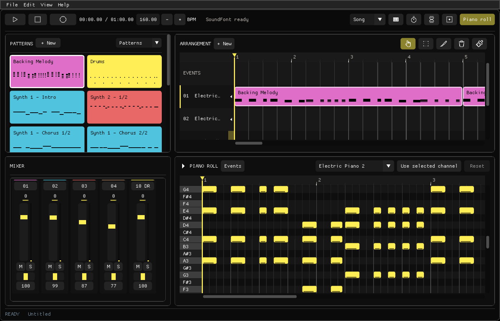

- **Toolbar** (top): play, record, tempo, and the metronome and recording toggles.
- **Patterns** (top left): the building blocks of your song.
- **Arrangement** (top right): where you place patterns on channel rows.
- **Mixer** (bottom left): volume, pan, mute and solo for each channel.
- **Piano roll** (bottom right): where you draw and edit notes.

Shortcuts act on the area you clicked last, so click the piano roll before pressing **Ctrl + A**, for example.

## 1. Start a song

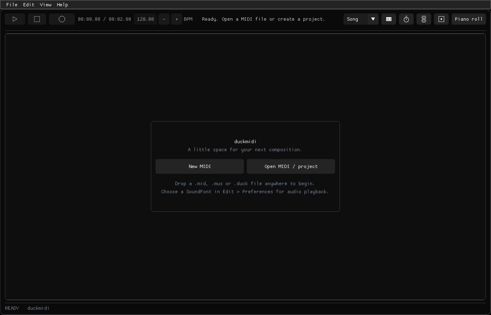

Click **New MIDI** to start fresh, or **Open MIDI / project** to open a `.mid`, `.mus` or `.duck` file. You can also drop a file onto the window.

A new song starts with a piano on channel 1 and drums on channel 10. Open **Project settings** (**/**) to set its name, tempo and time signature.

No sound? Open **Edit > Preferences** (**P**) and choose a SoundFont (`.sf2` or `.sf3`) or a MIDI output. *Full* packages come with a SoundFont and a sample song.

## 2. Listen and move around

| Shortcut | Action |
| --- | --- |
| Space | Play / pause |
| Shift + Space | Play from the beginning |
| Left / Right | Back / forward one second |
| Home / End | Go to the beginning / end |
| Ctrl + mouse wheel | Zoom |

- Choose **Song** in the toolbar to hear everything, or **Pattern** to hear just the pattern you're editing.
- Click the ruler to play from that spot. Right-drag along it to loop a section; **Escape** stops the loop.
- In the mixer, **M** mutes the selected row and **S** solos it. Click a volume number to type one.
- If a note gets stuck, **Shift-click Stop**.

## 3. Build a song from patterns

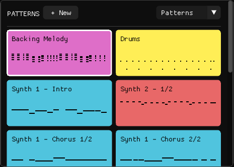

1. Click **+ New** in the pattern section.
2. Drag the card onto a row in the arrangement.
3. Double-click it to edit its notes.

Every copy of a pattern shares the same notes, so editing one changes them all. For a separate version, select the card and press **Ctrl + D**. Right-click a card to rename, recolor or delete it, and drag cards to reorder them.

In the arrangement, **Shift + drag** a placement to make a linked copy, drag its edge to change its length, or use the slice tool to split it.

> **Tip:** **Keypad +** jumps to the next pattern, or makes a new empty one. **Keypad −** goes back or removes the newest empty one.

### Channels and instruments

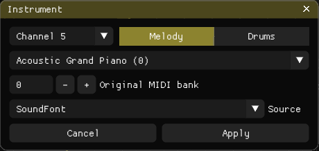

Click **+ New** beside **Arrangement** to add a channel, then pick **Melody** or **Drums** and an instrument. To change an existing channel, right-click its name or press **I**. **Up** and **Down** step through instruments.

## 4. Draw notes

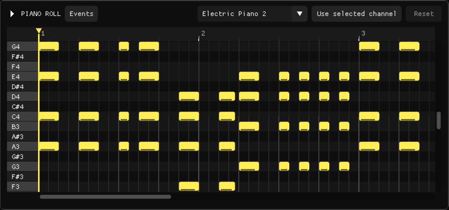

| Gesture | Action |
| --- | --- |
| Click | Add a note |
| Drag a note / its edge | Move it / change its length |
| Right-click or right-drag | Erase |
| Ctrl + drag | Select |
| Middle-drag a note | Copy it |
| Shift + drag inside a note | Draw a pitch bend |
| Alt while dragging | Ignore the grid |

The usual shortcuts work: **Ctrl + C / X / V**, **Ctrl + D** to duplicate, **Delete**, and **Ctrl + Z / Y**. **Ctrl + Q** snaps selected notes to quarter beats.

With the notes section focused, **Ctrl + Shift + C / X** copies or cuts selected notes with their pitch-bend points; **Ctrl + V** pastes them relative to the playhead. Change these shortcuts in **Edit > Keyboard shortcuts**. **Escape** clears selections in both the notes and events sections before closing the editor.

## 5. Play and record with your keyboard

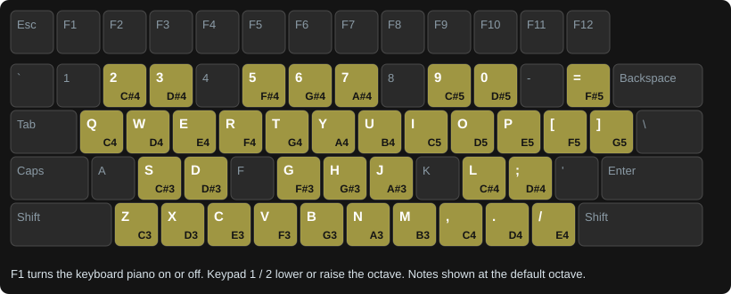

1. Press **F1** to turn your keyboard into a piano. The bottom row (**Z** to **/**) plays the lower octave and the top row (**Q** to **]**) the upper one.
2. **Keypad 1** and **Keypad 2** move down and up an octave.
3. Press **F5** to arm recording, then **Space** to start and stop.

| Toggle | Key | What it does |
| --- | --- | --- |
| Keyboard piano | F1 | Play notes with your keyboard |
| Metronome | F2 | Click along with the beat |
| Wait | F3 | Start recording on your first note |
| Overlap | F4 | Only replace notes your new take overlaps |

Turn the keyboard piano off when you want letter shortcuts back. To choose which key plays which drum, open the piano roll's top-left menu and choose **Percussion keyboard mapping**. Select a drum and click **Listen for key**, or **Listen for MIDI** and hit a pad on your controller.

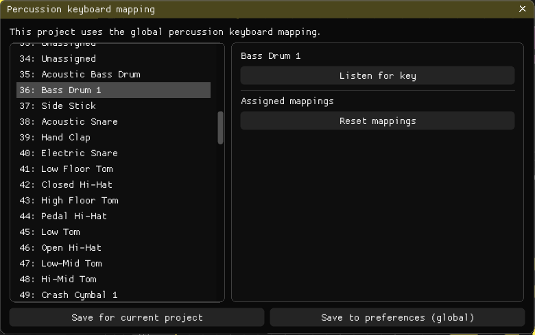

### Use a MIDI keyboard

1. Open **Edit > Preferences** (**P**) and expand **MIDI input**.
2. Under **Devices**, tick your keyboard. Click **Refresh** if you plugged it in after starting duckmidi. **Activity** shows the last messages it sent.
3. Play. Recording works the same as with the computer keyboard.

| Setting | What it does |
| --- | --- |
| Velocity curve | **Light** makes soft playing louder, **Heavy** makes it quieter. **Fixed velocity** plays every note at one level. |
| MIDI thru | Sends what you play to the MIDI output as well. |
| Controllers affect | **Keyboard only** keeps knobs and wheels on what you play; **Song** lets them change the song's channel too. |
| Input latency | **Auto**, or an offset in ms if recorded notes land early or late. |
| Invert sustain pedal | For pedals that work backwards. |
| Channel | Listen to one MIDI channel, or **All**. |

Controller data you record, like modulation, goes into the events in **Graph** mode (see below). If that event type already has points, it stays in **Point** mode.

### Control duckmidi from your controller

Right-click a mixer strip's volume, pan, **M** or **S** and choose **Learn MIDI control**, then move a knob or press a button. **Learn MIDI control from any device** works whichever keyboard you use. Right-click again to **Clear MIDI control**.

Transport and editing buttons are in **Edit > Preferences > MIDI input > MIDI controls**: Play, Stop, Record, Metronome, Quantize, Undo, Redo and the channel arrows. Click **Learn** beside one, or **Clear all** to start over. Choose **Toggle** for buttons that send on and off with each press; leave **Momentary** for the rest.

With **Pickup for knobs and faders** on, a knob only takes over once it reaches the current value, so the volume never jumps. Learned controls don't play notes or get recorded.

## 6. Add expression

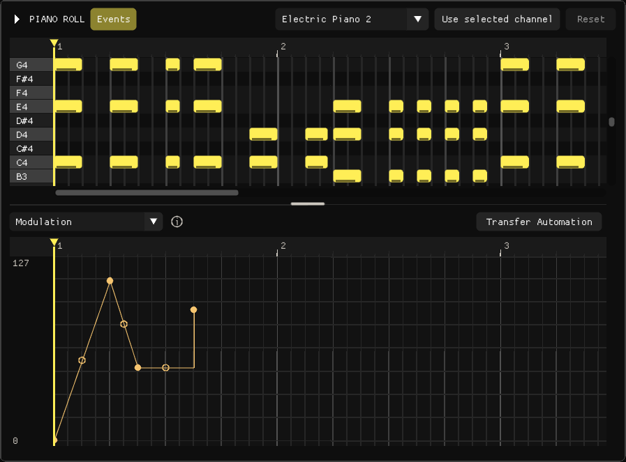

Events shape how notes sound over time: velocity, pitch bend, modulation, volume, pan, sustain and more.

1. Open a pattern and click **Events** (**Shift + E**).
2. Pick a controller from the dropdown.
3. Click to add points, or drag to draw a line. Drag a line's hollow handle to curve it, and right-click to erase.

For velocity, drag the note stems up or down. **Shift + right-click** a point to change its value or make it **Hold** until the next one.

Event types with data are marked in the application color; **Velocity** is marked once a note's velocity differs from the default of 100. **Copy** captures the displayed event type for the current note color; hold **Shift** for **Copy all** event types. **Paste** restores their original positions, regardless of the playhead. These buttons have their own clipboard. Copied velocities apply to notes with matching positions and pitches.

### Graph mode

Switch **Point** to **Graph** to draw an event type as bars, like a step sequencer. Each event type keeps its own mode, and duckmidi asks first if switching changes existing data.

- Drag to paint bars. Pick the bar width (**1/8** to **1/256**) beside the mode; hold **Alt** to paint freely.
- Right-drag erases. **Shift**-drag selected bars to raise or lower them together.
- **Snap bars** (or **Ctrl + Q**) moves bars to the nearest value row.

After the last bar, the value returns to its default.

### Repeating effects (LFOs)

An LFO repeats a wave, such as vibrato or a slow filter sweep.

1. Switch the pattern dropdown to **Automation** and click **+ New**.
2. Pick a controller and switch **Point** to **LFO**.
3. Set **Center**, **Speed** and **Amount**, then shape it with **Tension**, **Skew**, **Width** and **Invert**.
4. Place it on a channel and stretch it as long as you need.

### Effects for single notes

Normally all notes on a channel share their events. To give some notes their own, select them and press **Alt + C** to color them. Then pick that color's button before editing events, for example to bend one note while the rest of the chord stays put.

## 7. Use your own samples

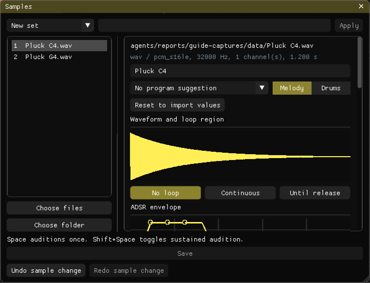

duckmidi can play your own recordings as instruments, and export them into your game.

1. Open **Edit > Samples** and click **Choose files** or **Choose folder**, or drop files in. WAV, MP3, AAC (M4A), Ogg, Opus, FLAC and AIFF all work.
2. Select a sample, name it, and choose **Melody** or **Drums** (with a trigger key). duckmidi detects the root note from the file name, its metadata or its pitch. Check it by ear.
3. Shape the sound: drag the envelope handles, pick a loop mode below the waveform and drag its edges. More controls are under **Gain, pan and ranges**, **Filter** and **Vibrato and effects**.
4. Type a set name and press **Enter** to save it as a sample set.
5. Open a channel's **Instrument** window, choose your set under **Source**, pick a **Preset** and click **Apply**.

| In Samples | Action |
| --- | --- |
| Space / Shift + Space | Listen once / keep playing |
| Shift + drag the waveform | Move the playback start or end |
| Alt while dragging a loop | Don't snap to a zero crossing |
| Middle-click a knob | Reset it |
| Ctrl + Z / Y | Undo / redo |

Sample sets are saved as WAV and SFZ files in the `samples` folder beside your preferences, so you can use them in other samplers too. See [Sample set files](sample-manifest.md) for details.

## 8. Save and export

**Ctrl + S** saves a `.duck` project. **Ctrl + E** opens the Export window.

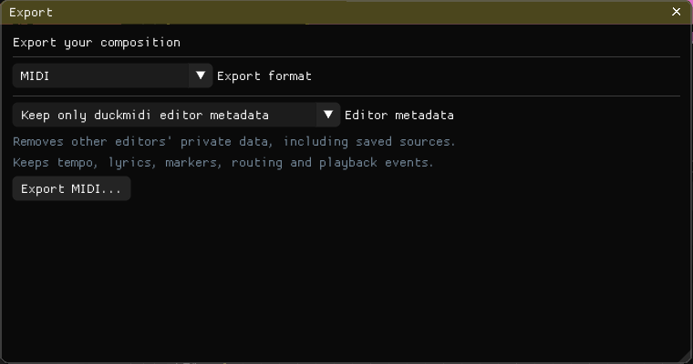

- **MIDI:** saves a standard MIDI file. Keep duckmidi's metadata to reopen it with all your settings, or strip it for plain MIDI.
- **Digital Audio:** renders WAV, MP3, AAC, Ogg Vorbis, Opus or FLAC at 48 kHz.
- **M64:** for SM64, HackerSM64 and sm64coopdx. See the [M64 guide](sm64-export.md).
- **OoT:** for a zeldaret/oot checkout. See the [OoT guide](oot-export.md).

Muted channels are left out of every export.

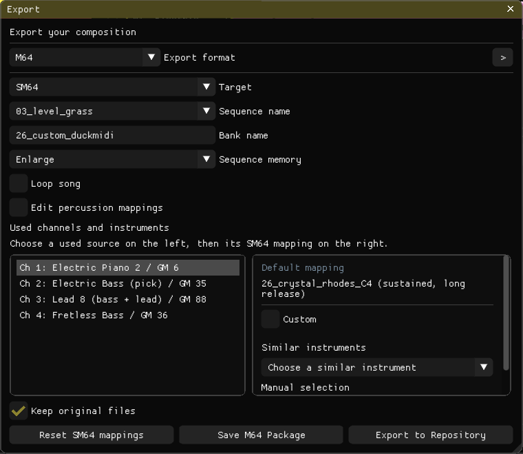

For games, check the instrument mappings on the right, then click **Save M64 Package** or **Save OoT Package** for a ZIP with install steps, or **Export to Repository** to install straight into your checkout. The first time, that button reads **Choose Folder**; you can change the folder later in **Edit > Preferences**.

To loop part of your song in-game, add **M64 - Loop Start** and **M64 - Loop End** song events.

### Custom game samples

To use your own samples in a game export, save them in **Edit > Samples** first. Then select a row in the export mappings, check **Custom**, and pick a **Sample Set** and preset.

- **Add** puts your sample into the game alongside the existing ones.
- **Replace** swaps out an existing game sample everywhere it's used, keeping the original as a `.bkp`.

For OoT, set the exporter's **Sample Set** to **Custom**. The game can't do everything duckmidi can, so some settings are converted or baked in; the warning window lists them. [Custom samples in SM64 and OoT](native-samples.md) has the details.

### Export warnings

If a game export had to adapt your song, the **Export warnings** window lists what changed, such as omitted controllers or rounded timing. If it says the export has *audible changes*, notes themselves had to change to fit, so give that part a listen.

### Repository history

duckmidi records every **Export to Repository** so you can undo it. Click the arrow beside **Export format** to open the history drawer, then **Revert** any export, or **Revert all**.

- **Enable** turns history on or off (on by default).
- With history off, files are written directly and can't be reverted. **Keep original files** decides whether the old versions are saved as `.bkp` files.
- **Initialize** makes your checkout's current audio the new starting point.

Keep your game's build stopped while exporting or reverting. See [How repository history works](repository-history.md) for more.

## More handy features

- **Turn an imported song into patterns:** **Edit > Generate Patterns** finds repeated phrases and makes them linked patterns.
- **Song events:** click the **Events** row in the arrangement to add tempo, time signature, key, markers and more. **MIDI Events** lists every MIDI message.
- **Check for updates:** **Help > Check for Update**. duckmidi only goes online when you ask it to (Windows only).

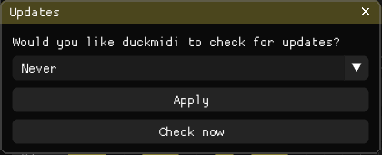

## Customize shortcuts

Open **Edit > Keyboard shortcuts**, pick an action and press its new keys. Mouse gestures, like the copy drags, are under **Mouse**.

Your settings are saved beside the program on Windows, in `~/Library/Application Support/duckmidi/` on macOS and in `~/.local/share/duckmidi/` on Linux. To edit the INI files by hand, close duckmidi first:

```ini
soundfont="C:\Music\my-font.sf2"
play_pause="Space"
color_selected_notes="Alt + C"
```
