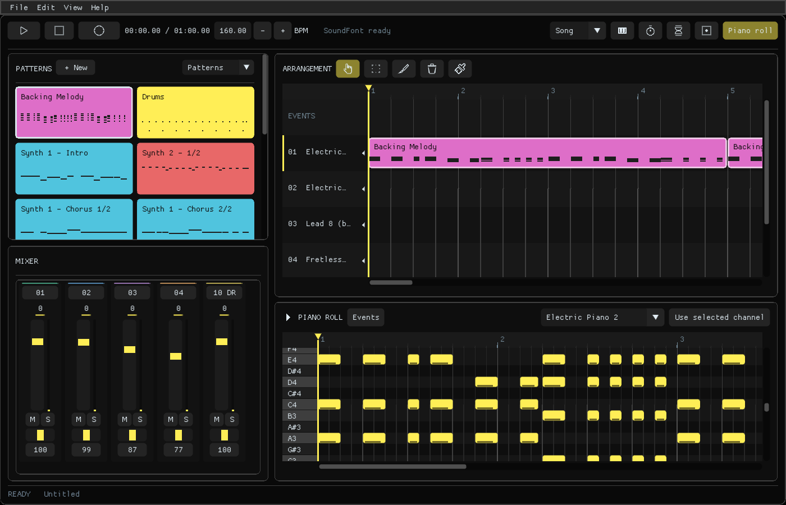
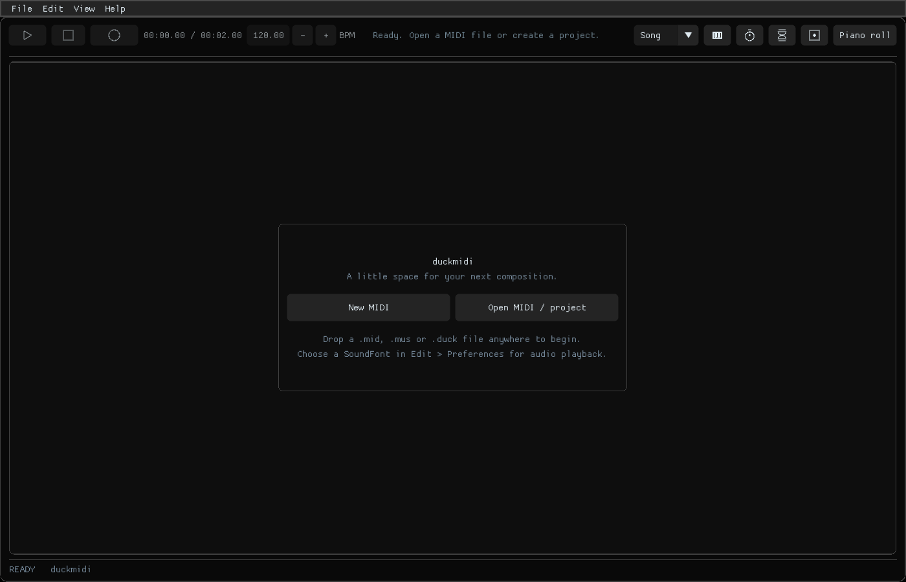
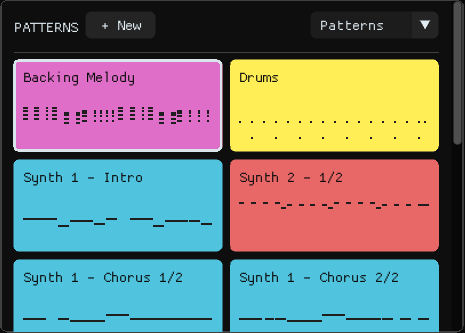
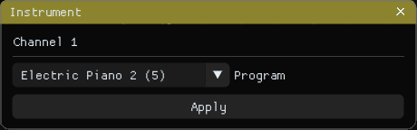
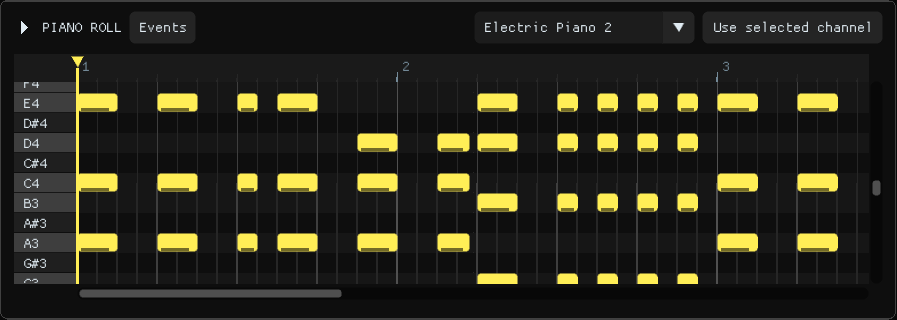
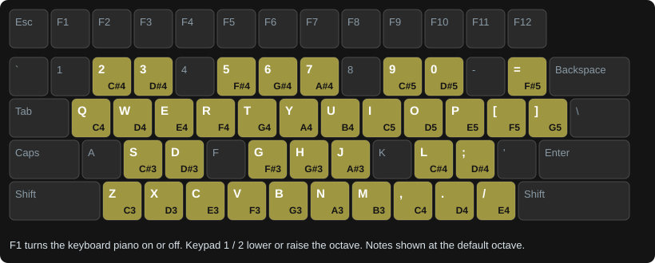
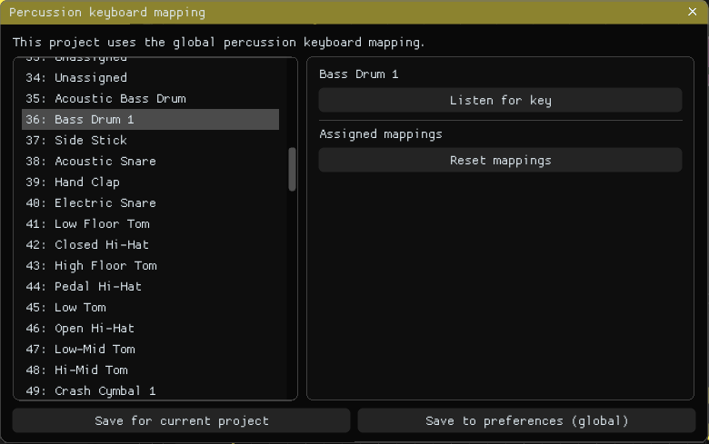
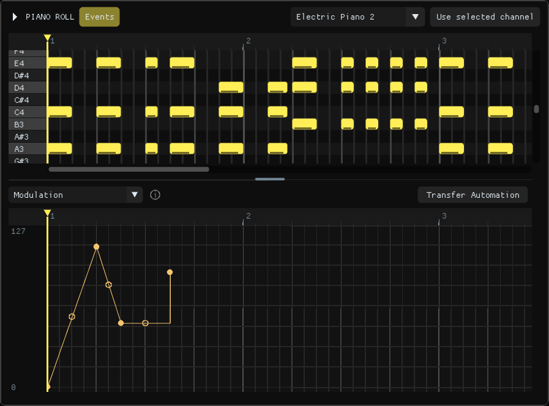
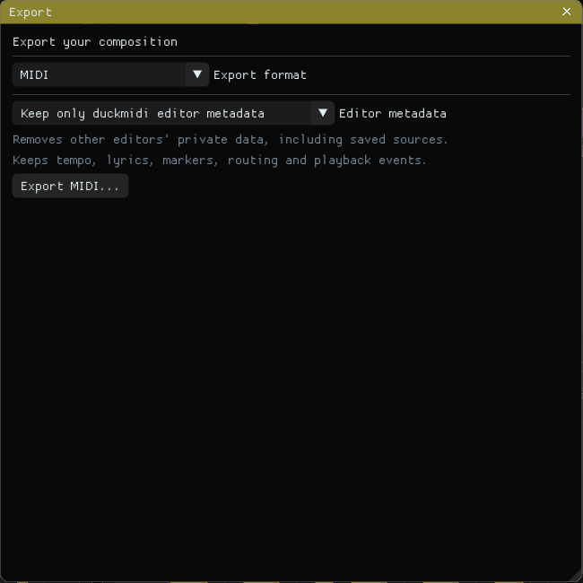
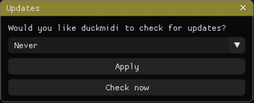

# Using duckmidi

This guide walks through the editor from your first note to a finished export. Each section stands on its own, so skip ahead if you want.

## A quick tour



The window has five areas:

- **Toolbar** (top): play, stop, record, the song position and tempo, and toggles for the metronome and other recording options.
- **Patterns** (top left): the building blocks of your song. Each card is a pattern of notes or events.
- **Arrangement** (top right): the playlist, where you place patterns on channel rows to build the song.
- **Mixer** (bottom left): volume, pan, mute and solo for each channel.
- **Piano roll** (bottom right): the pattern editor / piano roll, where you draw and edit notes.

Shortcuts act on the area you last clicked, so click the piano roll before pressing **Ctrl + A**, for example.

## Start a song



Click **New MIDI** to start from scratch, or **Open MIDI / project** to open a file. You can also drop a `.mid`, `.mus` or `.duck` file onto the window, or use the **File** menu later.

A new project starts with two channels ready to go: 
- Channel 1 shows MIDI Instrument #0, 'Acoustic Grand Piano'
- Channel 10 shows the 'Percussion' channel, a MIDI 1.0 convention

Open **Project settings** (**/**) to change the song's name, tempo or time signature, then click **Apply** or press **Enter**.

If you can't hear anything, open **Edit > Preferences** (**P**) and choose an SF2/SF3 SoundFont or an external MIDI output. 

Full packages come with a SoundFont and a sample song which opens when you first start *duckmidi*.

## Listen and move around

| Shortcut | Action |
| --- | --- |
| Space | Play / pause |
| Shift + Space | Play from the beginning |
| Left / Right | Move back / forward one second |
| Shift + Left / Right | Move back / forward a quarter bar |
| Home / End | Go to the beginning / end |

Choose **Song** in the toolbar to hear the whole arrangement, or **Pattern** to hear just the pattern you're editing.

Click the ruler above a grid to start playback from that spot. To repeat a section while you work on it, right-drag along the ruler; the highlighted part loops until you press **Escape**. This works in the playlist, the piano roll and the events editors, even past the last note of a short pattern.

Zoom with **Ctrl + mouse wheel**, or the wheel over the ruler. Grids show bars as the lightest lines, beats a shade darker and quarter beats darkest; the playlist adds quarter beats once you zoom in far enough.

### Mix your channels

Use the mixer to set each channel's volume and pan. 
- **M** mutes the selected playlist row
- **S** solos it. 

Click a volume number to type a value from 0 to 127; **Enter** applies it and **Escape** cancels.

If a note ever gets stuck, **Shift-click on Stop** to silence everything.

## Build a song from patterns



1. Click **+ New** in the pattern section, or pick an existing card.
2. Click a playlist row to place the pattern there, or drag its card into the arrangement.
3. Double-click a placement to open its notes in the piano roll.

Every placement of a pattern shares the same notes, so a change to one changes them all. To make a separate version, click the card and press **Ctrl + D**, or right-click it and choose **Duplicate**. The same menu renames, recolors (**Alt + C**) and deletes patterns. With the pattern section focused, **Ctrl + C** and **Ctrl + V** copy a pattern and paste it as a new one.

**Rearrange the cards** by dragging one within the pattern section. The card follows your mouse, the others close up behind it, and a space opens where it will land. Drop it there to move it. Placements in the song are not affected.

Select several placements to move them together. Drag a placement's edge to change how long it plays. The slice tool splits a placement into two linked parts of the same pattern.

### Choose instruments

Click a playlist row's instrument name, or press **I** with the playlist or piano roll focused, to open the **Instrument** window.



Pick an instrument from the dropdown, or press **Up** / **Down** to step through them while listening, then click **Apply** or press **Enter**. Choose **Drum kit** to turn the channel into the drum channel (channel 10 in General MIDI). On the drum channel, the dropdown lists drum kits first, then ordinary instruments; picking an instrument moves the part back to a free channel.

The piano roll's own instrument dropdown only changes what you hear while editing. **Use selected channel** copies the selected row's instrument into it.

## Draw and edit notes



| Gesture | Action |
| --- | --- |
| Click empty space | Add a note |
| Drag a note | Move it |
| Drag a note's edge | Change its length |
| Ctrl + drag | Select a group of notes |
| Right-click / right-drag | Erase notes |
| Alt + move or resize | Ignore snapping |
| Shift + drag inside a note | Draw a pitch bend |
| Middle-drag | Pan around |

**Ctrl + C / X / V** copies, cuts and pastes in the focused area. **Ctrl + D** duplicates the selection, **Delete** removes it, and **Ctrl + Z / Y** undoes and redoes. **Ctrl + Q** snaps the selected notes to quarter beats.

## Play and record with your keyboard

Your computer keyboard can play notes like a piano. The highlighted keys below are the piano keys, labelled with the note each one plays at the starting octave.



1. Open a note pattern and choose an instrument.
2. Press **F1** to turn on the keyboard piano.
3. Play the bottom row (**Z** to **/**) for the lower octave and the top row (**Q** to **]**) for the upper octave. The keys just above each row play the sharps.
4. Press **Keypad 1** or **Keypad 2** to move down or up an octave.
5. Press **F5** to arm recording, then **Space** to start. Press **Space** again to stop.

When a take ends, the piano roll is focused, so **Ctrl + A** and **Ctrl + Q** work on your new notes straight away.

| Toggle | Shortcut | Use |
| --- | --- | --- |
| Keyboard piano | F1 | Play notes with typing keys |
| Metronome | F2 | Hear the beat while playing |
| Wait | F3 | Start recording when you play the first note |
| Overlap | F4 | Replace only the existing notes your new notes overlap |

With Overlap off, a new take replaces the pattern's notes for the active color. Save first, or use Undo, if you want to try another take.

Turn the keyboard piano off when you want its letter keys to work as editor shortcuts again.

### Map drum sounds to keys

On the drum channel, each piano key can play any drum you like. Select a drum pattern or the drum channel, open the piano roll's top-left menu, and choose **Percussion keyboard mapping**.



1. Click a drum in the list to hear it.
2. Click **Listen for key**, then press the piano key you want for it.
3. Play the mapped keys to try your kit.
4. Save the mapping:
   - **Save for current project** keeps it in this project. Save the project file to keep it.
   - **Save to preferences (global)** makes it the default for every project without its own mapping.
   - **Enter** saves to whichever of the two this project currently uses, and closes the window.

**Use global mapping for this project** removes the project's own mapping, and **Reset mappings** clears the draft. Closing the window, or opening another project, discards unsaved changes. **Escape** stops listening for a key before it closes the window.

## Add expression with events

Events change how notes sound over time: velocity, pitch bend, modulation, volume, pan and other controllers.



1. Open a note pattern and click **Events**, or press **Shift + E**.
2. Choose **Velocity**, **Pitch bend**, **Modulation** or another controller from the dropdown. Hover any dropdown and scroll the mouse wheel to step through its choices.
3. For velocity, drag the note stems up or down. For controllers, use the gestures below.

| Gesture | Action |
| --- | --- |
| Click | Add a single point |
| Drag | Draw a line from where you pressed to where you release |
| Shift + click | Add a point connected to the nearest point |
| Shift + drag | Connect the start to the nearest point, then draw the line from there to where you release |
| Alt + click or drag | Place without snapping to the grid; the line preview snaps unless Alt is held |
| Drag a point | Move it |
| Drag a line's hollow handle | Bend the line into a curve |
| Right-click / right-drag | Erase points |
| Shift + right-click a point | Change its value or curve, or delete it |
| Ctrl + drag | Select points |

A short wobble while clicking still counts as a click, so you won't draw a line by accident. **Program change** is always placed as a single point, since an instrument choice has no in-between values.

**Curves between points.** Shift + right-click a point and hover **Curve**:

- **Line** moves smoothly to the next point.
- **Hold** keeps this point's value until the next point, then jumps to it. In the picture above, the flat step is a held point.

Event changes apply to notes on the same channel and color. When a line ends, the value returns to what it was before. For a sustain pedal, choose **Sustain** and drag along the line for as long as you want it held. A pitch bend drawn on a note moves with the note.

Press **Shift + Keypad +** or **Shift + Keypad −** to step through automation patterns, creating a new one after the last.

### Make a reusable LFO

An LFO is a repeating wave, such as a vibrato or a slow filter sweep, that you can place like any other pattern.

1. Switch the pattern section's dropdown to **Automation** and click **+ New**. With the piano roll hidden, **Shift + E** opens the Event Editor on an automation pattern, creating one if needed.
2. Choose a controller in the Event Editor and switch **Point** to **LFO**.
3. Set **Center** (the resting value), **Speed** (the rate) and **Amount** (the depth). **Tension**, **Skew**, **Width** and **Invert** shape the wave.
4. Place the automation pattern on the channel it should affect, and resize the placement to set how long it lasts.

Drag the knobs up and down. Middle-click a knob to reset it; hold **Alt** to ignore snapping. How a controller sounds depends on your SoundFont or MIDI device.

## Give notes their own effects

Normally every note on a channel shares the same events. Colors let some notes have their own.

1. Select notes in the piano roll and press **Alt + C**.
2. Pick a color. The notes move to their own port; the default swatch moves them back.
3. Color buttons appear beside the instrument dropdown. Choose one before editing events to affect only those notes.

For example, bend one long note while the rest of the chord stays put. To remove a color, Shift-click its button and choose **Delete port**; its notes return to the default and its events are removed.

Colored notes play independently in duckmidi and in exported MIDI files, although other players may ignore them. M64 export moves them to unused channels, or merges them with a warning.

MIDI files that use several ports open with each port in its own color. To merge them, open **Project settings** and choose **Combine original source ports** or **Combine ALL source ports**. Undo reverses the merge.

## Turn an imported song into patterns

Choose **Edit > Generate Patterns**, then **Generate**. Look over the preview and click **Apply**, or close it to keep the song as it was. Repeated phrases become linked patterns and controllers become automation patterns. **Ctrl + Z** undoes Apply.

## Save and export

**Ctrl + S** saves a `.duck` project, and **Ctrl + Shift + S** saves it under a new name. Projects from earlier duckmidi versions open normally and are saved in the current format.



### MIDI

1. Press **Ctrl + E** and select **MIDI**.
2. Choose an **Editor metadata** option. Keep duckmidi metadata to reopen the file with its editor details, or strip it for plain MIDI.
3. Click **Export MIDI** and choose a filename.

The file contains the song as you hear it: muted channels are left out.

### Audio

1. Press **Ctrl + E** and select **Digital Audio**.
2. Choose WAV, MP3, AAC, Ogg Vorbis, Opus or FLAC from **Codec**, and set its quality options.
3. Click **Export** and choose a filename.

Audio is rendered with your SoundFont at 48 kHz stereo. A progress bar shows while it renders; **Cancel audio export** stops it, and **Open file location** opens the folder when it's done. Sound from an external MIDI device is not recorded.

### M64

Choose **M64** in the format dropdown, review the instrument mappings, then click **Save M64 Package** or **Export to Repository** to install it into your SM64 project. Add **M64 - Loop Start** and **M64 - Loop End** song events to repeat part of the song. The [M64 guide](sm64-export.md) covers the details.

## Check for updates



After you open your first song, duckmidi asks whether to check for updates. Choose **On Launch** and click **Apply** to check each time duckmidi starts, or keep **Never**. Click **Check now** for a one-off check. duckmidi only goes online when you choose one of these.

You can open the window again from **Help > Check for Update**. When an update is available, click **Download update**, then **Restart and install** or **Install when duckmidi closes**. Your settings, layout and projects are kept. Updates are available on Windows.

## Customize shortcuts

Open **Edit > Keyboard shortcuts**, choose an action and press its new keys. **Escape** closes the active window first.

On Windows, preferences and layout are saved beside the program. On macOS they are in `~/Library/Application Support/duckmidi/`, and on Linux in `~/.local/share/duckmidi/`. To edit the INI files by hand, close duckmidi first. Paths and shortcuts are quoted, and action names use underscores:

```ini
soundfont="C:\Music\my-font.sf2"
play_pause="Space"
color_selected_notes="Alt + C"
```

Use `+` between keys, such as `"Shift + Alt + E"`. Percussion entries use drum names, such as `acoustic_snare="Z"`. Shortcuts saved by earlier versions keep working.
